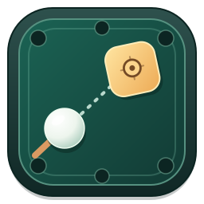
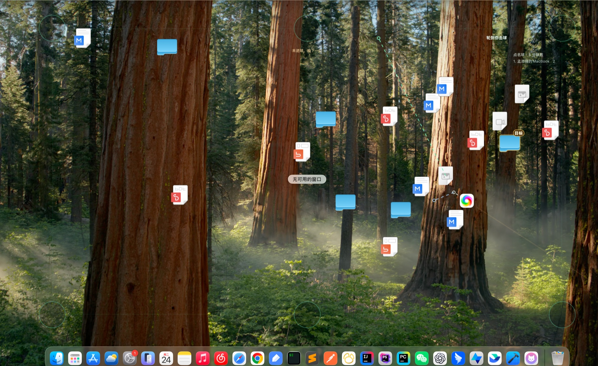

# DeskPool · Desktop Icon Billiards

[简体中文](README.md) · [Downloads](https://github.com/15589321245/DeskPool/releases) · [First cross-platform game](#first-cross-platform-game)

DeskPool turns local desktop icons into pool balls. The macOS app plays on the desktop and can host, join, or run a solo game. The Windows client plays in its own window using local desktop icons and can join a Mac-hosted room.



| Feature | macOS | Windows |
| --- | --- | --- |
| Solo play and hosting | Supported | Use a Mac to host |
| Joining a Mac room | Room discovery or direct IP | Direct IPv4 |
| Assigned Balls, Free Scoring, Called Ball | Supported | Uses the host's mode |
| Turn reminder | In-game message, sound, and macOS notification | In-window message and sound |
| Display | Transparent desktop layer | Windowed or full screen |

## Install

### macOS

Requires macOS 13 or later. The universal ZIP supports Intel and Apple silicon. Extract the Mac ZIP from Releases and move `DesktopIconBilliards.app` to Applications. Allow local network access when prompted. Playing with desktop icons requires access to the Desktop folder. The demo works with sample icons.

Double-click the app for solo play, or launch the icon demo from Terminal:

```bash
open /Applications/DesktopIconBilliards.app --args --demo
```

### Windows

The first Windows client targets Windows 10/11 and joins rooms hosted by a Mac.

- **Executable:** When an x64 build is available, extract the Windows build bundle and double-click `DeskPool.exe`.
- **Run from source:** Install Python 3.11 or later from [python.org](https://www.python.org/downloads/windows/) with Tcl/Tk enabled. Extract the Windows LAN ZIP and double-click `Start-DeskPool.bat`. In a full repository checkout, find the script in the `windows/` directory. The source client uses the Python standard library.

You can also join by IP from PowerShell at the repository root:

```powershell
py -3 windows\deskpool.py --join 192.168.0.75
```

The client picks Chinese or English from the system locale. Use `--lang zh` or `--lang en` to override it. Use `--demo` for numbered balls, which also appear when no desktop icons are available.

## First cross-platform game

1. **Start the room on a Mac.** Connect everyone to the same LAN. Quit any running copy, then run in Terminal:

   ```bash
   open /Applications/DesktopIconBilliards.app --args --host
   ```

2. **Find the host's IPv4 address.** On the host Mac, open the active connection in System Settings → Network and check its TCP/IP details. Replace the example `192.168.0.75` below with this address.
3. **Join from Windows.** Open DeskPool, enter the host's IPv4 address, and click Join. Other Macs can use:

   ```bash
   open /Applications/DesktopIconBilliards.app --args --join 192.168.0.75
   ```

   Mac players can also browse rooms with `--discover`. The Windows client can join rooms hosted by Mac 1.5.0 or 1.5.1.
4. **Start the round.** After players appear in the Mac lobby, the host selects a mode and clicks Start. A round accepts returning participants during play. New players can join after the round ends.

### Controls and rules

- Move to aim. Hold the left mouse button to charge, then release to shoot. The guide shows direction and the charge controls travel distance.
- With **ball in hand**, click an open spot on the table away from pockets, rails, and other balls. Then aim and shoot.
- A multiplayer turn has a 20-second shot clock. Whether a player can shoot again depends on the game mode.

| Mode | Objective |
| --- | --- |
| Assigned Balls | Green markings identify your balls. Keep shooting after a legal pot. The first player to clear their own balls wins. An opponent's ball or a neutral ball is respotted and the next player gets ball in hand. |
| Free Scoring | Every icon ball counts. Keep shooting after a legal pot. The final ranking uses the number of balls potted. |
| Called Ball | Look for the gold Target badge. Pot only the target to score one point and keep shooting at a new target. Potting another ball or the cue ball respots all icon balls from that shot and gives the next player ball in hand. First to five wins. Up to five players. |

| Key | Action |
| --- | --- |
| `G` | Toggle aim guide |
| `Esc` | Quit |
| Mac `H` | Show controls and network diagnostics |
| Mac `R` | Restart solo play or return to the lobby as host |
| Mac `Ctrl+Option+D` | Switch between desktop access and play |
| Windows `F11` | Toggle full screen |

### Troubleshooting

If joining fails, check that the host is running, the IPv4 address is correct, and all players are on the same LAN. Guest Wi-Fi can isolate devices. Allow local network access on the host and allow the host application through the firewall for TCP and UDP port 7777. The game can use TCP for ball positions if UDP is unavailable. If room discovery fails on Mac, join by IP.

If the game shows your turn but there is no macOS banner, allow banners or alerts for Desktop Icon Billiards in System Settings → Notifications and check Focus settings. The Windows client uses an in-window message and sound.

## Build from source

```bash
git clone https://github.com/15589321245/DeskPool.git
cd DeskPool
```

**macOS** with Xcode or Command Line Tools:

```bash
swift run PhysicsTests
swift run AppTests
./build-app.sh
open build/DesktopIconBilliards.app --args --host
```

`build-app.sh` builds for the current Mac architecture. On **Windows**, run in PowerShell:

```powershell
py -3 -m unittest discover -s windows
py -3 -m pip install pyinstaller
py -3 -m PyInstaller --noconfirm --onefile --windowed --name DeskPool --icon assets/deskpool.ico --add-data "assets/deskpool.png:assets" windows\deskpool.py
```

The executable is `dist\DeskPool.exe`. The [Build DeskPool workflow](.github/workflows/build.yml) builds Mac and Windows packages. Download them from Artifacts in the Actions run.

### Automatic releases

After pushing the commit you want to release, push a tag that matches the app version in `build-app.sh`. For example:

```bash
git tag v1.5.1
git push origin v1.5.1
```

The tag run publishes three ZIP files to [Releases](https://github.com/15589321245/DeskPool/releases) after the Apple silicon, Intel Mac, and Windows x64 builds all pass. Branch pushes, pull requests, and manual runs only build artifacts.

## Source and license

`Sources/` contains the Mac app, physics, and host rules. `windows/` contains the Windows guest. `Tests/` contains the macOS tests. The host decides collisions, scores, and fouls. Guests convert normalized positions to their own table size. Desktop files and icon images stay on each player's device.

[MIT license](LICENSE). Thanks to LXG's [original Windows project](https://github.com/liuxiaogang-com/desktop-icon-billiards) and the contributors to the [macOS port](https://github.com/18710603308/mac-desktop-icon-billiards).
