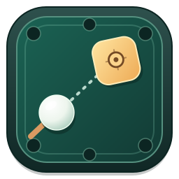
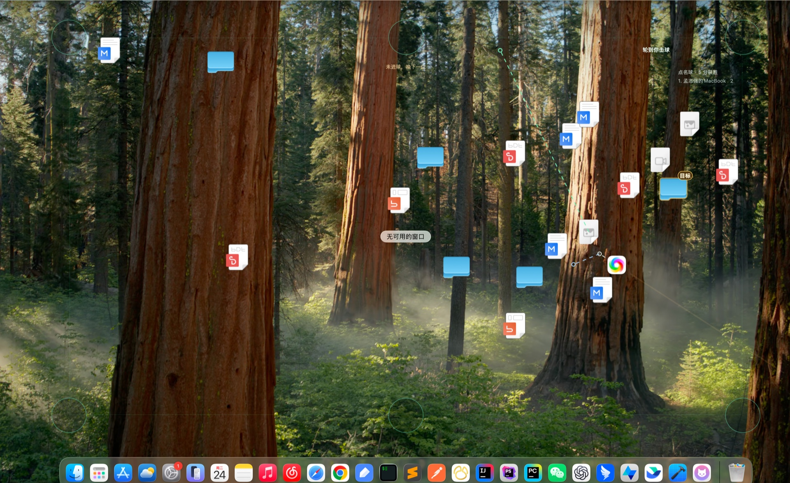

# DeskPool · 桌面图标台球

[English](README.en.md) · [下载](https://github.com/15589321245/DeskPool/releases) · [联机教程](#第一次跨平台联机)

DeskPool 把本机桌面图标变成台球。macOS 版在桌面上运行，可单机练习、创建房间或加入房间。Windows 版在独立窗口里显示本机桌面图标，可加入 Mac 创建的房间。



| 功能 | macOS | Windows |
| --- | --- | --- |
| 单机、创建房间 | 支持 | 房主使用 Mac |
| 加入 Mac 房间 | 搜索房间或输入 IP | 输入房主 IPv4 |
| 分球竞速、自由计分、点名球 | 支持 | 跟随房主选择 |
| 回合提醒 | 游戏提示、提示音和 macOS 通知 | 窗口提示和提示音 |
| 球桌 | 透明桌面图层 | 可切换全屏的独立窗口 |

## 安装

### macOS

需要 macOS 13 或更新版本。通用包支持 Intel 和 Apple 芯片。解压发行版中的 Mac ZIP，把 `DesktopIconBilliards.app` 拖进「应用程序」。首次启动根据提示允许访问本地网络。真实桌面模式需要读取桌面图标，也可以用 `--demo` 玩示例图标。

双击应用进入单机模式。也可以从终端启动：

```bash
open /Applications/DesktopIconBilliards.app --args --demo
```

### Windows

首版面向 Windows 10/11，作为 Mac 房间的加入端。

- **EXE 版**：有 Windows x64 构建时，下载并解压 Windows 构建包，双击 `DeskPool.exe`。
- **源码版**：用 [Python 官方安装器](https://www.python.org/downloads/windows/) 安装 Python 3.11 或更新版本，保留自带的 Tcl/Tk。解压 Windows 联机 ZIP 后双击 `Start-DeskPool.bat`。如果下载的是整个仓库，启动脚本在 `windows\` 目录。运行源码无需安装第三方 Python 包。

也可在仓库根目录的 PowerShell 里直接指定房主地址：

```powershell
py -3 windows\deskpool.py --join 192.168.0.75
```

Windows 默认按系统语言选择界面。可用 `--lang zh` 或 `--lang en` 切换。加 `--demo` 使用编号球。桌面没有可读图标时也会显示编号球。

## 第一次跨平台联机

1. **用 Mac 创建房间。** 让所有设备连到同一个局域网。退出已运行的旧版，再在 Mac 终端执行：

   ```bash
   open /Applications/DesktopIconBilliards.app --args --host
   ```

2. **找到房主 IPv4。** 在房主 Mac 的「系统设置 → 网络」中打开当前连接的详细信息，查看 TCP/IP。下文的 `192.168.0.75` 是示例，换成房主实际的局域网地址。
3. **Windows 加入。** 打开 Windows 客户端，输入房主 IPv4，点击「加入」。其他 Mac 可以用：

   ```bash
   open /Applications/DesktopIconBilliards.app --args --join 192.168.0.75
   ```

   Mac 也可以用 `--discover` 搜索房间。Windows 客户端可加入 Mac 1.5.0 或 1.5.1 创建的房间。
4. **开始。** 待玩家出现在 Mac 准备室，房主选模式并点「开始游戏」。玩家无需就绪。比赛开始后只有已参赛玩家可以重连，新玩家可在一局结束后加入。

### 击球与规则

- 移动鼠标瞄准，按住左键蓄力，松开击球。辅助线显示方向，实际滚动距离由力度决定。
- **自由球**时，轮到的人点击远离其他球、袋口和边缘的台面空处摆白球，再瞄准击球。
- 多人局每回合有 20 秒倒计时。轮到时可以连续击球的情形由当前模式判定。

| 模式 | 怎么赢 |
| --- | --- |
| 分球竞速 | 图标有绿色标记的是自己的球。合法进球可以继续，先打完自己所有球的人赢。误进别人的球或中立球会复位，并给下一位自由球。 |
| 自由计分 | 所有图标都可进袋，合法进球可继续。清台后按进球数排名。 |
| 点名球 | 找带金色「目标」标记的图标。只打进目标球得 1 分并继续，系统换目标。误进其他球或白球入袋，本杆进袋图标全部复位，下一位摆白球。先到 5 分赢，最多 5 人。 |

| 快捷键 | 作用 |
| --- | --- |
| `G` | 开关辅助线 |
| `Esc` | 退出 |
| Mac `H` | 打开操作面板和联机诊断 |
| Mac `R` | 单机重开或由房主返回准备室 |
| Mac `Ctrl+Option+D` | 暂时操作桌面，再按一次返回 |
| Windows `F11` | 切换窗口和全屏 |

### 连不上怎么办

检查房主应用仍在运行、IP 是房主地址、两台电脑在同一局域网。访客 Wi-Fi 可能隔离设备。确保 Mac 允许本地网络访问，防火墙允许房主应用使用 TCP/UDP 7777。UDP 不通时，球位会退回 TCP。Mac 搜索不到房间时可直接用 IP 加入。

游戏里看到轮到自己的提示、但没有 macOS 横幅时，在「系统设置 → 通知」里给「桌面图标台球」开启横幅或提醒，并检查勿扰模式。Windows 客户端在窗口里提示并播放提示音。

## 从源码构建

```bash
git clone https://github.com/15589321245/DeskPool.git
cd DeskPool
```

**macOS**（安装 Xcode 或 Command Line Tools）：

```bash
swift run PhysicsTests
swift run AppTests
./build-app.sh
open build/DesktopIconBilliards.app --args --host
```

`build-app.sh` 生成当前 Mac 架构的应用。**Windows** 在 PowerShell 中运行：

```powershell
py -3 -m unittest discover -s windows
py -3 -m pip install pyinstaller
py -3 -m PyInstaller --noconfirm --onefile --windowed --name DeskPool --icon assets/deskpool.ico --add-data "assets/deskpool.png:assets" windows\deskpool.py
```

Windows EXE 位于 `dist\DeskPool.exe`。仓库的 [Build DeskPool 工作流](.github/workflows/build.yml) 可在 GitHub Actions 里构建 Mac 和 Windows 工件。工作流工件可以下载测试，是否发布到 Releases 由仓库维护者决定。

## 源码与许可证

`Sources/` 是 macOS 客户端、物理和房主规则，`windows/` 是 Windows 加入端，`Tests/` 是 macOS 测试。房主负责碰撞、计分和犯规，加入者接收归一化球位并显示本机图标。桌面文件和图标不会发送给房主。

采用 [MIT 许可证](LICENSE)。感谢 LXG 的[原版 Windows 项目](https://github.com/liuxiaogang-com/desktop-icon-billiards)和 [macOS 移植项目](https://github.com/18710603308/mac-desktop-icon-billiards)的贡献者。
